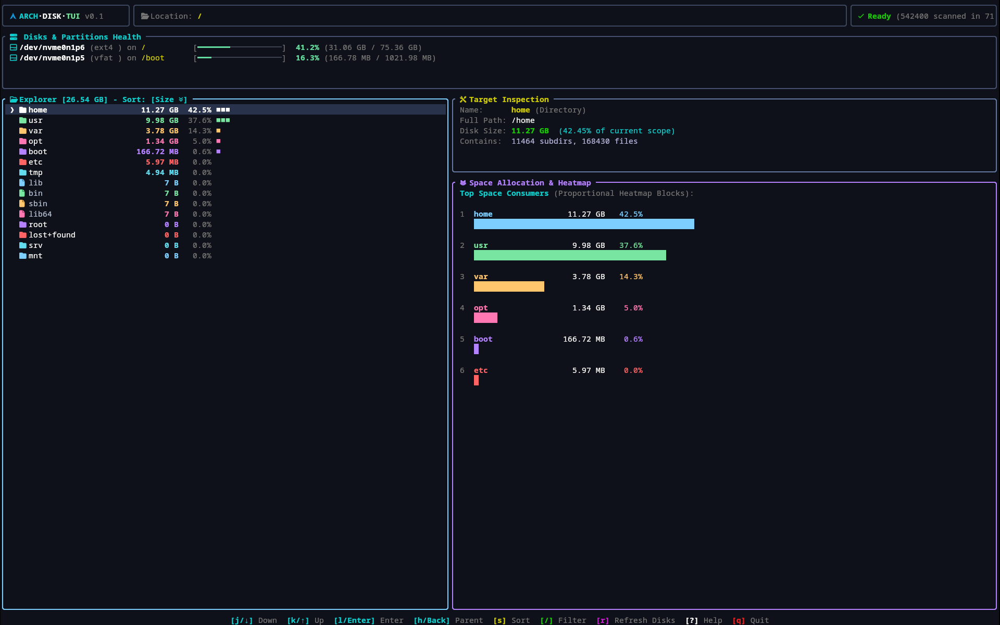

<div id="top" align="center">

  

  <br/><br/>

  <h1>ARCH·DISK·TUI</h1>

  <p align="center">
    <strong>A fast, modern terminal disk space analyzer and heatmap for Linux</strong>
  </p>

  <p align="center">
    <a href="https://github.com/emirkefi/arch-disk-tui/stargazers"></a>
    <a href="https://github.com/emirkefi/arch-disk-tui/releases"></a>
    <a href="https://github.com/emirkefi/arch-disk-tui/blob/master/LICENSE"></a>
    <a href="https://www.rust-lang.org/"></a>
    <a href="https://archlinux.org"></a>
    <a href="https://crates.io/crates/arch-disk-tui"></a>
    <a href="https://crates.io/crates/arch-disk-tui"></a>
  </p>

  <p align="center">
    <a href="#install"><strong>Install</strong></a> &nbsp;&bull;&nbsp;
    <a href="#features"><strong>Features</strong></a> &nbsp;&bull;&nbsp;
    <a href="#controls"><strong>Controls</strong></a> &nbsp;&bull;&nbsp;
    <a href="#cli--config"><strong>CLI &amp; Config</strong></a>
  </p>

</div>

---

## Overview

**`arch-disk-tui`** is a fast terminal disk-space analyzer and interactive heatmap written in Rust. Inspired by *WizTree* and *ncdu*, it provides non-blocking multi-threaded directory scanning, inline share bars, a 2D block treemap toggle, a global Top-N largest files view, and safe FreeDesktop Trash integration.

---

<a id="features"></a>
## Highlights

- **Inline Size Bars & Heatmap**: Every row displays a proportional bar showing its share of the parent directory, colored by file category (media, archives, code, caches, documents, binaries) with optional Nerd Font or ASCII icons.
- **Header Partition Gauge & Breadcrumbs**: Live partition usage bar (`412 GB / 512 GB · 81%`) that turns yellow and red as it fills, paired with a clickable breadcrumb bar (`/ › home › emir › Downloads`).
- **2D Treemap & Top-N Files Views**: Toggle a 2D proportional block treemap (`t`) or view the largest individual files across the entire scan (`f`).
- **Safe Trash & Batch Multi-Select**: Mark multiple items with `Space` (`3 selected · 8.4 GB`), move to the FreeDesktop Trash by default (`d`), or permanently delete (`D`) with system-file protection guards.
- **Accurate Accounting**: Deduplicates hard links by `(dev, ino)`, skips symlinks and pseudo-filesystems (`/proc`, `/sys`, `/dev`, `/run`), and surfaces permission-denied folders with a lock indicator (`[needs sudo]`).
- **Themes & Scripting**: Built-in themes (`arch`, `catppuccin`, `gruvbox`, `mono`, plus `NO_COLOR` support), `config.toml` support, and headless `--export-json` / `--export-csv` flags.

---

<a id="install"></a>
<a id="quick-install"></a>
## Install

### Cargo (crates.io)

```bash
cargo install arch-disk-tui
```

### Arch Linux (AUR / PKGBUILD)

```bash
yay -S arch-disk-tui-bin
```

<details>
<summary><strong>Alternative Install &amp; Uninstall Methods (Curl Script, Source, Make)</strong></summary>
<br/>

#### Automated Install Script (downloads binary or builds from `master`)

```bash
curl -fsSL https://raw.githubusercontent.com/emirkefi/arch-disk-tui/master/install.sh | bash
```

#### Build from Source

```bash
git clone https://github.com/emirkefi/arch-disk-tui.git
cd arch-disk-tui
cargo build --release
./target/release/arch-disk-tui
```

#### Uninstall

```bash
curl -fsSL https://raw.githubusercontent.com/emirkefi/arch-disk-tui/master/uninstall.sh | bash
# Or if using Makefile: sudo make uninstall
```

</details>

---

<a id="controls"></a>
## Controls

| Key / Mouse | Action |
|:---:|:---|
| <kbd>j</kbd> / <kbd>k</kbd> / <kbd>&uarr;</kbd> / <kbd>&darr;</kbd> / Scroll | Move selection up or down |
| <kbd>g</kbd> / <kbd>G</kbd> | Jump to top / bottom |
| <kbd>Ctrl+d</kbd> / <kbd>Ctrl+u</kbd> | Half-page scroll down / up |
| <kbd>l</kbd> / <kbd>Enter</kbd> / Double-Click | Enter directory (or locate file in Top-N view) |
| <kbd>h</kbd> / <kbd>Backspace</kbd> / Right-Click | Go back to parent directory (remembers cursor position) |
| <kbd>~</kbd> | Jump to `$HOME` directory |
| <kbd>Space</kbd> | Mark / unmark item for multi-select batch actions |
| <kbd>d</kbd> | Move selected or marked item(s) to FreeDesktop Trash |
| <kbd>D</kbd> / <kbd>Del</kbd> | Permanently delete selected or marked item(s) |
| <kbd>s</kbd> / <kbd>S</kbd> | Cycle sort mode (`Size`, `Name`, `Count`) / Reverse sort direction |
| <kbd>/</kbd> | Live search prompt with match count and character highlighting |
| <kbd>t</kbd> | Toggle 2D proportional block Treemap view |
| <kbd>f</kbd> | Toggle global Top-N largest files view |
| <kbd>y</kbd> / <kbd>o</kbd> | Copy path to clipboard (`y`) / Open in `$EDITOR` or `xdg-open` (`o`) |
| <kbd>T</kbd> / <kbd>r</kbd> | Cycle color theme (`T`) / Refresh partition metrics (`r`) |
| <kbd>?</kbd> / <kbd>q</kbd> | Open help cheatsheet (`?`) / Quit (`q`) |

---

<a id="cli--config"></a>
<a id="usage"></a>
## CLI & Configuration

```bash
# Analyze current directory or a specific path
arch-disk-tui
arch-disk-tui /var

# Stay on one filesystem (like du -x) and exclude patterns
arch-disk-tui / -x --exclude node_modules --exclude .git

# Choose a theme or icon mode
arch-disk-tui --theme catppuccin --icons nerd

# Export scan results to JSON or CSV for scripting
arch-disk-tui ~/Projects --export-json report.json
arch-disk-tui ~/Projects --export-csv report.csv
```

Optional persistent settings can be placed in `~/.config/arch-disk-tui/config.toml`:

```toml
theme = "arch"          # "arch", "catppuccin", "gruvbox", "mono", "no_color"
icons = "auto"          # "auto", "nerd", "ascii", "none"
one_file_system = false
exclude = ["node_modules", ".git"]
```
